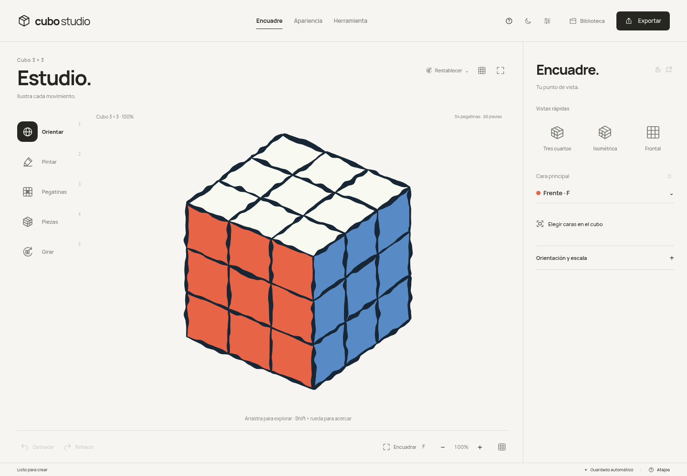

# Cubo Studio · Estudio abierto

Una mesa de trabajo abierta para ilustrar cubos: lienzo sin marco, herramientas independientes, opciones por contraste y tipografía con distintos tamaños y pesos. Conserva el motor, la verificación, el historial, los formatos de biblioteca y todas las funciones de Cubo Studio 1.14.

## Descargar

- [Aplicación para Windows (.exe)](https://github.com/sebaawl/cubestudio/raw/refs/heads/main/dist/Cubo-Studio-Minimal.exe)
- [Paquete completo (.zip)](https://github.com/sebaawl/cubestudio/raw/refs/heads/main/dist/Cubo-Studio-Minimal.zip)
- [Versión autónoma HTML](https://github.com/sebaawl/cubestudio/raw/refs/heads/main/dist/Cubo-Studio-Minimal.html)



## Usar la aplicación

- **Windows:** abrir `dist/Cubo-Studio-Minimal.exe`. Conserva el contenedor nativo y las bibliotecas WebView2 del programa original; requiere los mismos componentes de Windows y WebView2. La ejecución del contenedor nativo debe comprobarse en Windows: este trabajo se desarrolló en Linux.
- **Sin instalar:** abrir `dist/Cubo-Studio-Minimal.html` en un navegador Chromium actual (Chrome o Edge). Es un archivo autónomo y no necesita conexión a Internet.
- **Desarrollo:** desde este directorio, ejecutar `python3 -m http.server 8000 --bind 0.0.0.0`. El punto de entrada es `index.html`.

La aplicación sigue guardando la sesión y los presets localmente. Los datos de un navegador, un archivo HTML y la aplicación de Windows pueden pertenecer a almacenamientos diferentes. Para trasladar la biblioteca, usar **Biblioteca → Exportar biblioteca** en el original e **Importar** en la nueva versión.

## Organización

- La cabecera reúne **Encuadre**, **Apariencia** y **Herramienta**, junto a ayuda, entorno, biblioteca y exportación.
- Los botones independientes de la izquierda son **Orientar**, **Pintar**, **Pegatinas**, **Piezas** y **Girar**, con las teclas 1–5. El contraste oscuro indica la herramienta seleccionada.
- Los ajustes abiertos de la derecha cambian con la herramienta. Las opciones de estilo, selección, flechas y resolución se eligen con botones específicos.
- Los valores se pueden escribir o ajustar con **− / +**. Opacidad y escala usan porcentajes; los demás campos muestran sus unidades.
- En **Encuadre**, las vistas rápidas tienen iconos propios. **Orientación y escala** despliega los detalles de cámara. En **Exportar**, **Recorte y nombre de archivo** reúne los ajustes menos frecuentes.
- Bajo el lienzo están el historial, la verificación contextual, el encuadre y la escala.
- **Restablecer**, junto al lienzo, agrupa la herramienta actual, los colores originales y el estudio completo. Los cambios se pueden deshacer.
- **Entorno** conserva los temas anteriores, los bloqueos, el orden de pestañas, la posición del panel y las ventanas independientes. Se añadieron los temas neutros **Papel** y **Carbón**.

En pantallas pequeñas, las herramientas se sitúan sobre el cubo y los ajustes debajo. Los nombres permanecen visibles. La cuadrícula de transparencia se activa junto al lienzo y recuerda su estado; por defecto, el fondo es continuo.

## Reconstruir

```sh
python3 scripts/build.py
```

Solo requiere Python 3. El script genera `index.html` y los entregables HTML/EXE de `dist/`. Inserta `ui/studio.css`, `ui/studio.js` y la fuente variable Manrope en el HTML recuperado, sin modificar sus quince scripts originales. La tipografía y su licencia quedan incluidas en el archivo autónomo: no se descargan al abrir la aplicación.

Para generar el `.exe`, sustituye exclusivamente el recurso HTML reservado del ejecutable original y recalcula el checksum PE. Comprueba la huella SHA-256 del original, el tamaño disponible, la ausencia de firma Authenticode, el contenido descomprimido y que el código nativo, los metadatos y las bibliotecas no cambien. No requiere recompilar el contenedor de Windows.

## Verificar

```sh
python3 -m pip install -r requirements-dev.txt
python3 -m playwright install chromium
python3 tests/verify.py
python3 scripts/package.py
```

Puede usarse un navegador instalado mediante `CUBO_CHROME=/ruta/al/navegador`. La suite levanta su propio servidor local, usa sesiones temporales y guarda el informe, las capturas y los archivos exportados en `test-results/`. No modifica datos reales del usuario.

Comprueba integridad del código, presencia de los controles originales, equivalencia de estado y píxeles con el original, edición, cámara, giros, captura y flechas, estilos, biblioteca, verificación, descargas reales, bloqueos, ventanas, persistencia y varios tamaños de pantalla. También verifica las opciones por contraste, los límites de los valores directos y el arranque del recurso comprimido con la red desconectada.

`scripts/package.py` actualiza el ZIP, las huellas y el informe de entrega. Exige que las 14 pruebas hayan pasado y que el informe corresponda exactamente al HTML que se empaqueta.

## Archivos

| Archivo | Contenido |
| --- | --- |
| `src/original.html` | Aplicación recuperada del ejecutable, sin modificaciones. |
| `src/Cubo-Studio-1.14.exe` | Ejecutable original conservado para reconstrucciones verificables. |
| `ui/studio.css` | Sistema visual, distribución y adaptación a pantallas pequeñas. |
| `ui/studio.js` | Organización de controles y mejoras de presentación. |
| `scripts/build.py` | Generación reproducible de HTML y ejecutable. |
| `scripts/package.py` | Empaquetado de una compilación validada y actualización de las huellas. |
| `tests/verify.py` | Pruebas funcionales y comparación con el original. |
| `docs/funciones.md` | Inventario y ubicación de funciones. |
| `docs/validacion.md` | Resultados y alcance de la validación. |
| `licenses/WebView2.txt` | Aviso de licencia del componente nativo, conservado del original. |
| `licenses/Manrope-OFL.txt` | Licencia OFL de la fuente variable incluida. |
